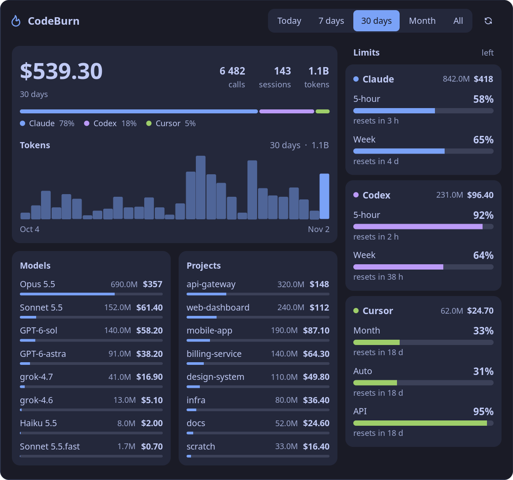

<h1 align="center">🔥 CodeBurn for Noctalia</h1>

<p align="center"><strong>Your Claude, Codex, and Cursor spend and limits, one click from the bar.</strong></p>

<p align="center">
  <a href="LICENSE"></a>
  <a href="https://github.com/noctalia-dev/noctalia-shell"></a>
  <a href="https://github.com/dvaxert/codeburn-rs"></a>
  <a href="https://github.com/getagentseal/codeburn"></a>
</p>

<p align="center">
  
</p>

<p align="center"><sub>Screenshot with made-up numbers and projects. Colors follow your Noctalia theme.</sub></p>

## Where it comes from

| Project | Role |
|---|---|
| [CodeBurn](https://github.com/getagentseal/codeburn) by AgentSeal | The original tool, and the idea behind all of this |
| [codeburn-rs](https://github.com/dvaxert/codeburn-rs) | A Rust rewrite of part of CodeBurn. Reads the session files and prints the JSON this plugin shows |
| **noctalia-codeburn** | This repo: the bar widget and panel for [Noctalia](https://github.com/noctalia-dev/noctalia-shell) |

## Sixty seconds

You need Noctalia 5.3 or newer and `codeburn-rs` on `PATH` or in `~/.cargo/bin`:

```bash
git clone https://github.com/dvaxert/codeburn-rs
cargo install --path codeburn-rs --locked
git clone https://github.com/dvaxert/noctalia-codeburn
```

Point a path source at this repo and enable the plugin. In `~/.local/state/noctalia/settings.toml`:

```toml
[plugins]
enabled = ["dvaxert/codeburn"]

[[plugins.source]]
kind = "path"
location = "/path/to/noctalia-codeburn"
name = "codeburn"
```

Add the widget to a bar:

```toml
"dvaxert/codeburn:bar"
```

Then reload and click the flame:

```bash
noctalia msg config-reload
```

## What you see

**The bar** shows a flame and the cost of the selected period. While the first scan is still going, it shows `—`.

**The panel** has a period switch at the top and two columns below it.

The main column follows the period:

- The total, with calls, sessions, and tokens beside it.
- A stacked bar with each tool's share of the spend.
- Tokens per day. Hover a bar to read its date, tokens, and cost.
- The top models and projects. Each bar is that row's share of the period's total cost.

The side column has one card per tool. The header shows the tool's tokens and cost for the period. The meters below it are always the live windows, whatever the period:

- A full meter means the window is almost untouched, and the percent is what is left.
- Under 15% left, the meter turns red and gets a warning sign.
- If a tool does not answer, its card says the limits could not be read. The spend still renders.

## Settings

| Key | Default | What it does |
|---|---|---|
| `binary` | empty | Path to `codeburn-rs`. Empty tries `PATH`, then `~/.cargo/bin/codeburn-rs` |
| `period` | `today` | Window requested when the service starts. The panel can switch it until settings change |
| `refresh_sec` | `60` | How often the service runs the binary, from 15 to 3600 |

## How it works

The service runs this command and publishes the JSON on the `view` state key. The bar and panel only render that key:

```bash
codeburn-rs status --format menubar-json --period <period>
```

The run times out after 60 seconds. The period buttons send `today`, `week`, `30days`, `month`, or `all`.

## Development

`panel.luau` reloads on save. Changes to `plugin.toml` and `translations/` show up after the plugin is cycled:

```bash
noctalia msg plugins disable dvaxert/codeburn
noctalia msg plugins enable dvaxert/codeburn
```

Check the manifest offline with `noctalia plugins lint codeburn`.

## License

[MIT](LICENSE).

All the numbers come from [codeburn-rs](https://github.com/dvaxert/codeburn-rs), a Rust rewrite of part of [CodeBurn](https://github.com/getagentseal/codeburn) by AgentSeal. This plugin is not affiliated with AgentSeal.
